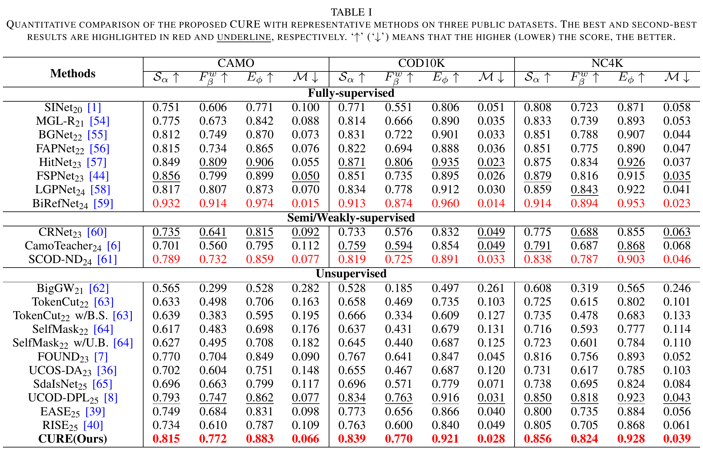
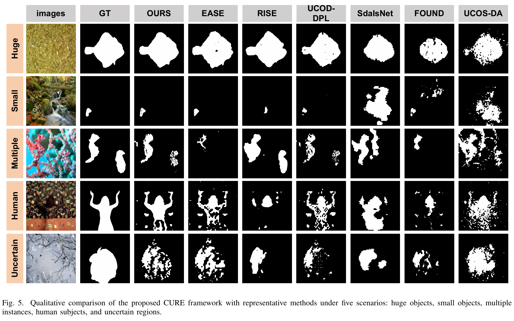

# CURE: Consistency and Uncertainty-driven REfinement for Unsupervised Camouflaged Object Detection

## Abstract

Unsupervised camouflaged object detection (UCOD) is challenging because camouflaged objects closely resemble their surroundings and manual annotations are unavailable. Existing pseudo-label-based methods may accumulate errors when coarse initial labels remain in use throughout training, while adversarial refinement introduces an additional discriminator and minimax optimization. We propose CURE, a Consistency and Uncertainty-driven REfinement framework that coordinates established consistency- and uncertainty-based principles for UCOD pseudo-label refinement without a parameterized adversarial discriminator. CURE uses the initial pseudo-labels only during a brief warm-up stage and subsequently adopts teacher predictions as supervision. Its Spatial-Level Weighting (SLW) strategy combines teacher confidence with student disagreement under feature-level Dropout to assign pixel-wise supervision weights. This construction preserves spatial alignment and introduces no additional learnable perturbation module. The Interactive Feedback Decoder (IF-Dec) employs role-dependent routing and normalized uncertainty feedback to refine ambiguous boundaries and local structures. The Target-Aware Asymmetric Exponential Moving Average (TA-AEMA) further adjusts the teacher update using confidence and consistency statistics from target-relevant regions, rather than applying fixed momentum throughout training. Extensive experiments on three UCOD benchmarks demonstrate that CURE achieves state-of-the-art performance among existing unsupervised methods.

## Quantitative Comparison

  

## Qualitative Comparison

  

